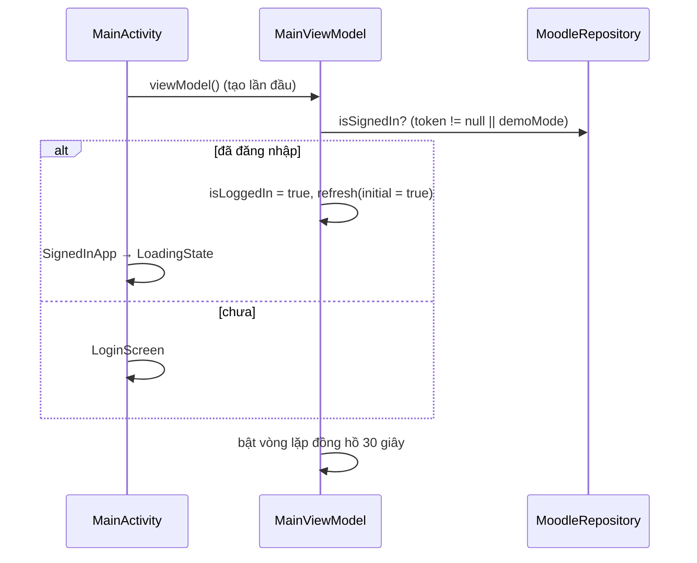
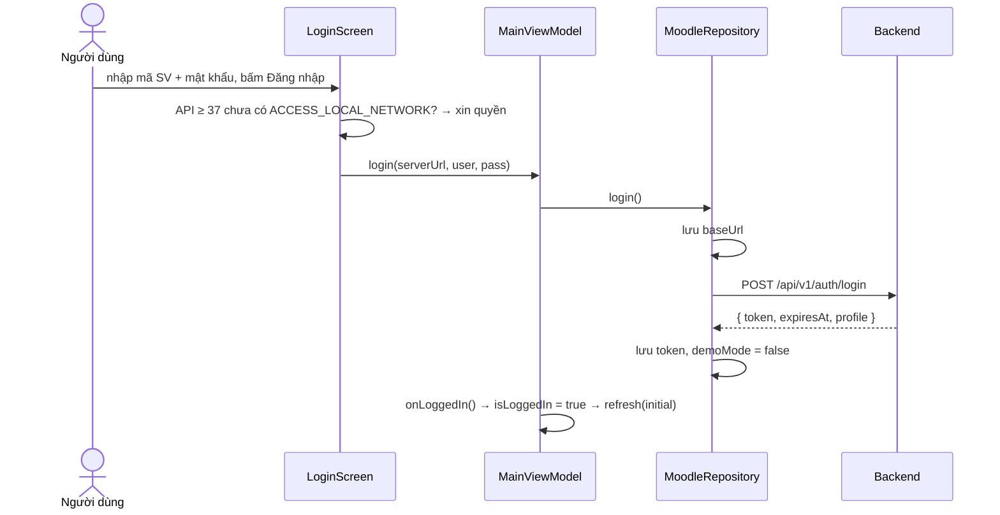
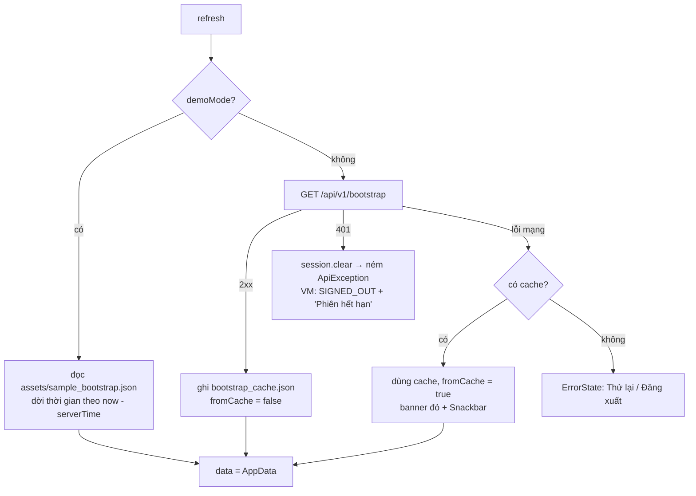
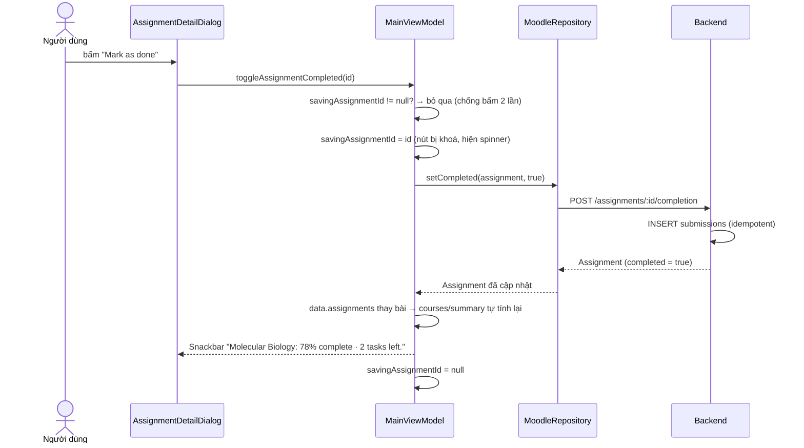
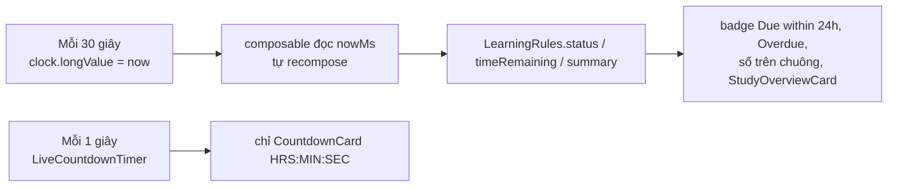

# Moodle USTH Mobile App — Giải thích code & workflow

Tài liệu này đi **theo code**: file nào làm gì, hàm nào quan trọng, dữ liệu chảy qua đâu và vì sao thiết kế như vậy.
Danh sách chức năng và schema CSDL đã có sẵn ở [`CHUC_NANG_VA_CSDL.md`](CHUC_NANG_VA_CSDL.md); cách chạy backend ở
[`../backend/README.md`](../backend/README.md). Tài liệu này không lặp lại các phần đó mà trỏ tới chúng khi cần.

---

## 1. Bức tranh tổng thể

Repo gồm hai phần chạy độc lập, nói chuyện với nhau qua REST/JSON:

| Phần | Ngôn ngữ / công nghệ | Vai trò |
|---|---|---|
| `app/` | Kotlin, Jetpack Compose, Material 3, MVVM | App Android cho sinh viên |
| `backend/` | Node.js ≥ 22.13 (`node:http`, `node:sqlite`), không cần `npm install` | API giả lập Moodle + CSDL SQLite |

App **không dùng thư viện mạng nào** (không Retrofit/OkHttp/Room/Hilt): dùng `HttpURLConnection` + `org.json` có sẵn trong Android,
`SharedPreferences` + một file JSON làm cache. Nhờ đó `app/build.gradle.kts` chỉ có Compose, Material 3, lifecycle và activity.

```
┌──────────────────────────── App Android ────────────────────────────┐        ┌──────────── Backend ───────────┐
│ Compose UI (screens/dialogs/components)                              │        │ server.js → app.js (router)    │
│        │ đọc biến state / gọi hàm                                     │        │        │                       │
│        ▼                                                              │        │        ▼                       │
│ MainViewModel  ── nowMs (đồng hồ 30s) ── LearningRules (quy tắc)      │  HTTP  │ services.js (nghiệp vụ)        │
│        │                                                              │ ─────► │        │                       │
│        ▼                                                              │  JSON  │        ▼                       │
│ MoodleRepository ── MoodleApi ──► JsonMapper ──► AppData (model)      │ ◄───── │ db.js (SQLite) ◄── seed.js     │
│        │                                                              │        └────────────────────────────────┘
│        ├─ SessionStore: token, baseUrl, demoMode, bootstrap_cache.json│
│        └─ assets/sample_bootstrap.json (chế độ xem thử)               │
└───────────────────────────────────────────────────────────────────────┘
```

**Ý tưởng cốt lõi** (đọc hiểu được cái này là hiểu 80% repo):

1. App chỉ gọi **một** endpoint `GET /api/v1/bootstrap` để lấy *toàn bộ* dữ liệu của sinh viên → giữ trong một `AppData` duy nhất.
2. Mọi màn hình đều là hàm thuần của `AppData` + đồng hồ. Trạng thái "sắp hạn/quá hạn", % tiến độ… **được tính lại ở app** bằng
   `LearningRules` (cùng công thức với backend), nên đồng hồ chạy mà không phải gọi lại API.
3. Chỉ có 3 thao tác ghi: đăng nhập/đăng xuất, đánh dấu hoàn thành (POST/DELETE), đánh dấu thông báo đã đọc.
4. Ba "chế độ dữ liệu" cùng đi qua một repository: **online**, **offline (cache)**, **demo (assets)**.

---

## 2. Backend (`backend/`)

### 2.1. Khởi động — `src/server.js`

1. Đọc biến môi trường `PORT` (8080), `HOST` (0.0.0.0), `DB_FILE` (`backend/data/moodle-usth.db`), `NODE_ENV`.
2. `openDatabase(DB_FILE)` mở SQLite và chạy `SCHEMA` (toàn bộ `CREATE TABLE IF NOT EXISTS`).
3. Nếu có cờ `--reset`/`--reset-only` hoặc DB chưa seed (`!isSeeded`) → `resetDatabase(db)` xoá sạch và seed lại.
   `npm run reset` = `--reset-only` (seed xong thoát).
4. Nếu dữ liệu seed cũ hơn 1 ngày → in cảnh báo (vì deadline seed là *tương đối*, lâu ngày sẽ thành Overdue hết).
5. `createServer(createApp(db, ...)).listen(...)` rồi in các URL: localhost, emulator (`10.0.2.2`), và IP LAN để dùng cho điện thoại thật.
6. Bắt `SIGINT/SIGTERM` để `db.close()`.

### 2.2. Router tự viết — `src/app.js`

Không dùng Express. `makeRoutes(allowReset)` trả về **danh sách API**, mỗi API là một object
`{ method, path, auth, run(ctx) }`, ví dụ `{ method: "GET", path: "/api/v1/courses/:id", auth: true, run(ctx) {...} }`.
Hàm `matchPath("/api/v1/courses/:id", "/api/v1/courses/web")` so từng đoạn sau khi `split("/")` và trả `{ id: "web" }`
(không khớp thì `null`) — không dùng regex. `createApp(db, { clock, allowReset, log })` trả về hàm `handle(req, res)`:

```
OPTIONS?  → 204 (CORS)
1. vòng for qua danh sách API, matchPath()  → không path nào khớp  → 404 not_found
                                             → khớp path, sai method → 405 method_not_allowed
2. route.auth ? authenticate(...)            → null                 → 401 unauthorized
3. params = decodeParam(...)  (% sai → 400 invalid_path)
   body   = (POST) ? await readJson(req) : null   // giới hạn 64 KB, quá → 413, sai JSON → 400
4. result = await route.run({ db, user, params, query, body, now, failedLogins })
→ trả JSON 200  (hoặc { status, headers, body } nếu API muốn tự quyết, như CSV)
catch HttpError → { error: { code, message } } với status tương ứng;  lỗi khác → 500
finally → log "METHOD path → status (ms)"
```

Chi tiết đáng chú ý:

- **`clock` được tiêm vào** (`clock = () => Date.now()`), handler nhận `now` thay vì tự gọi `Date.now()`. Test dùng đồng hồ giả để
  kiểm tra "trạng thái bài đổi theo thời gian" (`test("status follows the clock")`).
- Handler nhận `ctx` thay vì `req/res` → handler là hàm thuần dễ test, và `app.js` là nơi duy nhất biết về HTTP.
- `Cache-Control: no-store` và header CORS `*` được gắn trong `send()`.
- `/api/v1/dev/reset` chỉ được thêm vào bảng route khi `allowReset` (tức `NODE_ENV !== "production"`).
- `/api/v1/reports/grades.csv` là route duy nhất trả `{status, headers, body}` kèm `Content-Disposition: attachment`.

### 2.3. Xác thực — `src/auth.js`

| Hàm | Làm gì |
|---|---|
| `hashPassword(pw)` | Sinh salt 16 byte, `scryptSync(pw, salt, 32)`, lưu `"salt:hash"` (hex). |
| `verifyPassword(pw, stored)` | Tách `salt:hash`, băm lại, so bằng `timingSafeEqual` (chống timing attack). |
| `createSession(db, userId, now)` | Token ngẫu nhiên 32 byte base64url, ghi bảng `sessions`, hạn 30 ngày. |
| `authenticate(db, header, now)` | Regex `Bearer <token>`, `JOIN sessions ⨝ users WHERE token=? AND expires_at > ?`. Trả `user` (kèm `token`) hoặc `null`. |
| `deleteSession` | Dùng cho logout. |

Login (`POST /auth/login` trong `app.js`) chuẩn hoá `username` về chữ thường nên mã SV không phân biệt hoa/thường, và trả cùng một thông báo lỗi
cho "sai user" lẫn "sai mật khẩu" (không lộ user nào tồn tại).

### 2.4. Nghiệp vụ — `src/services.js`

Đây là file quan trọng nhất của backend. Các khái niệm chính:

**Trạng thái bài tập** — `assignmentStatus(a, now)`:

```
completed            → DONE
dueAt <= now         → OVERDUE
dueAt - now <= 24h   → URGENT
còn lại              → UPCOMING
```

**Truy vấn gốc `ASSIGNMENT_SELECT`**: `assignments ⨝ courses ⨝ enrollments(user) ⟕ submissions(user)`.
`JOIN enrollments` chính là cơ chế *phân quyền theo dữ liệu*: sinh viên chỉ thấy bài của môn mình đăng ký; `LEFT JOIN submissions` cho biết
bài đã xong/điểm/nhận xét của riêng sinh viên đó. Mọi hàm khác (`listCourses`, `learningSummary`, `semesterOverview`…) đều xây trên `listAssignments`.

**Ghi:**
- `markCompleted` — idempotent: chỉ `INSERT INTO submissions` nếu chưa `completed`.
- `unmarkCompleted` — nếu `score != null` thì ném `409 already_graded`, ngược lại `DELETE`.
- `markNotificationRead` — `UPDATE ... SET read_at = COALESCE(read_at, ?) WHERE id=? AND user_id=?` (không ghi đè lần đọc đầu; `changes === 0` → 404,
  cũng chặn đọc thông báo của người khác).

**Tính điểm:**
- `gradeOf(assignments)` = `Σ(score·contribution) / Σ(contribution)` trên các bài *đã chấm*, làm tròn 1 chữ số; chưa có bài chấm → `null`.
- `gradeComponents(assignments)` — với mỗi thành phần trong `CATEGORIES` (Attendance 10, Mid-term & labs 30, Final project 60): điểm TB có trọng số, `gradedWeight`,
  `publishedWeight` và `status`: `NOT_GRADED` (chưa chấm bài nào) → `IN_PROGRESS` (đã chấm một phần) → `GRADED` (`gradedWeight ≥ weight` thành phần).
- `semesterOverview` — điểm TB học kỳ có trọng số **theo tín chỉ**, bỏ qua môn chưa có điểm.
- `learningSummary` — `pending`, `urgent`, `recentDone` (xong trong 14 ngày), `done/total/progress`.

**Học kỳ hiện tại** (`currentSemester`) = bản ghi `semesters` có `starts_at` lớn nhất.

**`bootstrap(db, user, now)`** gom tất cả: `profile`, `semester`, `summary`, `courses` (mỗi môn kèm `gradeComponents`, `announcements`, `resources`),
`assignments`, `timetable`, `notifications` và `serverTime`. `serverTime` quan trọng: app dùng nó để dời mốc thời gian của dữ liệu mẫu (xem §3.3).

> `bootstrap` lấy danh sách bài **một lần** rồi chia theo môn để tính `toCourse` và `gradeComponents` (trước đây gọi lại `getCourse` cho từng môn, mỗi lần một truy vấn `listAssignments`). Test `bootstrap course data matches the course endpoints` bảo đảm kết quả vẫn khớp `/courses/:id`.

**`gradeReportCsv`** thoát ký tự (`"` → `""`, bọc nháy khi có `,` hoặc xuống dòng) và thêm BOM `` ở đầu để Excel đọc đúng UTF‑8.

### 2.5. CSDL & seed — `src/db.js`, `src/seed.js`

- `openDatabase` bật `PRAGMA foreign_keys = ON; journal_mode = WAL`. `:memory:` dùng cho test và `export-sample`.
- `resetDatabase(db, now)` chạy trong `transaction()` (BEGIN/COMMIT/ROLLBACK): xoá bảng theo thứ tự `TABLES` (con trước cha, để không vi phạm FK) → `seed(db, now)` → ghi `meta.seeded_at`.
- `seed.js` sinh dữ liệu mô phỏng. **Deadline là tương đối**: mỗi bài có `due` tính bằng giờ so với `now` (âm = đã quá hạn), ví dụ `proposal` còn ~6h42m.
  `academicTerm(now)` suy ra học kỳ từ tháng (≥9 → kỳ 1; tháng 1 → kỳ 1 của năm trước; còn lại → kỳ 2). `DEMO_ACCOUNTS` = `ba22-041` và `ba22-087`, mật khẩu `usth2025`.

### 2.6. Script xuất dữ liệu mẫu — `scripts/export-sample.js`

Tạo DB `:memory:`, `resetDatabase(db, now)`, gọi `bootstrap` cho `ba22-041` và ghi ra `app/src/main/assets/sample_bootstrap.json`.
File này là **nguồn dữ liệu của chế độ xem thử** trong app. Chạy lại bằng `npm run export-sample` mỗi khi đổi schema/payload bootstrap, nếu không
chế độ demo có thể lệch với backend.

### 2.7. Test — `test/api.test.js` (16 test, `node --test`)

Mỗi lần chạy: DB `:memory:` + `resetDatabase(db, NOW)` với `NOW` cố định (25/10/2026 10:00) + server thật trên cổng ngẫu nhiên + `fetch` thật.
Nhóm test: auth (sai mật khẩu, bảo vệ endpoint, login không phân biệt hoa/thường, logout vô hiệu token), số liệu khớp thiết kế, bộ lọc `todo|urgent|done`,
cách ly dữ liệu giữa hai sinh viên, mark/undo, 409 khi bài đã chấm, trạng thái đổi theo `clock`, thông báo, bootstrap, CSV, 404 dạng JSON.

---

## 3. App Android (`app/src/main/java/com/example/moodle_usth_mobile_app/`)

### 3.1. Mô hình dữ liệu — `data/model/Models.kt`

`AppData` là *một* snapshot gồm: `profile`, `semester`, `courses`, `assignments`, `sessions` (lịch học), `notifications`, mốc đầu/cuối học kỳ, `serverTimeEpochMs`.
Các model chính và logic nhỏ nằm ngay trong chúng:

- `Assignment.isCompleted = completedAtEpochMs != null`, `isGraded = score != null`.
- `AssignmentCategory` (enum có `weight` và `tone`); `fromKey` rơi về `MIDTERM_LABS` nếu key lạ → app không crash khi backend thêm loại mới.
- `Course.progress` tính từ `done/total` (làm tròn); `gradeText` hiện `—` khi chưa có điểm.
- Thời gian luôn là `...EpochMs: Long`; `weekday` của `ClassSession` theo quy ước JS/Calendar: `0 = Chủ nhật … 6 = Thứ bảy`.

### 3.2. Lớp mạng — `data/remote/`

**`MoodleApi.kt`** — client REST ~100 dòng:

- Nhận thẳng `SessionStore` (`MoodleApi(session)`) và đọc `session.baseUrl`, `session.token` **mỗi lần gọi**, nên đổi địa chỉ server hay đăng nhập xong thì request tiếp theo tự dùng giá trị mới.
- `request(method, path, body)`: chạy trong `Dispatchers.IO` (mạng không được chạy trên luồng giao diện); `openConnection()` đặt timeout 10 s, `Accept: application/json`, và `Authorization: Bearer` nếu có token; mã ngoài 200..299 → `readError()` đọc `{error:{code,message}}` và ném `ApiException(status, code, message)`.
- `ApiException : IOException` — kế thừa `IOException` nên trong `MoodleRepository.load()` phải bắt `ApiException` **trước** `IOException`. ViewModel thì bắt `Exception` rồi dùng `if (error is ApiException && error.status == 401)` để phân biệt.
- `setCompleted(id, completed)` chọn `POST` hay `DELETE` tuỳ cờ. `downloadGradeReport()` cắt tên file trong header `Content-Disposition` bằng `indexOf/substring`.

**`JsonMapper.kt`** — JSON → model. Điểm hay:

- `timeShiftMs` được **cộng vào mọi mốc thời gian** (`dueAt`, `completedAt`, `postedAt`, `createdAt`, mốc học kỳ, `serverTime`). Với dữ liệu thật `timeShiftMs = 0`; với dữ liệu mẫu nó bằng `now - serverTime` để deadline luôn "tương đối với hiện tại".
- Các hàm `getLongOrNull/getDoubleOrNull/getStringOrNull(json, key)` kiểm tra `isNull` trước, vì `org.json` mặc định trả `0`/`"null"` cho JSON `null`. `toList(array)` đổi `JSONArray` thành `List` bằng vòng `for`.
- Enum lạ dùng `Kind.entries.find { it.name == ... } ?: giá_trị_mặc_định` — mapper chịu được giá trị mới từ server.
- Mapper **không dùng** `progress/pending` server gửi mà chỉ lấy `done/total`; `progress` do model tự tính.

### 3.3. Lưu trữ & repository — `data/local/`, `data/repository/`

**`SessionStore`** (SharedPreferences `moodle_session` + file `filesDir/bootstrap_cache.json`): `baseUrl` (mặc định `BuildConfig.API_BASE_URL`), `token`, `demoMode`, `readCache/writeCache`.
`lastSyncedAtMs` lưu thời điểm tải bootstrap thành công gần nhất (để hiện "đồng bộ lúc …" kể cả khi đang dùng cache).
`clear()` xoá token, cờ demo, thời điểm đồng bộ và file cache, **nhưng giữ `baseUrl`** (người dùng không phải gõ lại địa chỉ server sau khi đăng xuất).
Token, cache và lịch nhắc được loại khỏi Auto Backup / chuyển máy (`res/xml/backup_rules.xml`, `data_extraction_rules.xml`).

**`MoodleRepository`** — cửa duy nhất mà ViewModel dùng. Mỗi hàm rẽ nhánh theo `session.demoMode`:

| Hàm | Online | Demo |
|---|---|---|
| `load()` | `api.bootstrap()` → ghi cache + `lastSyncedAtMs` → `LoadResult(data, false, now)`. Lỗi `IOException` → đọc cache → `LoadResult(..., fromCache=true)`; không có cache thì ném lại lỗi. `ApiException 401` → `session.clear()` rồi ném lên. | Đọc `assets/sample_bootstrap.json`, tính `shift = now - serverTime`, `JsonMapper(timeShiftMs = shift)`, áp lại các thay đổi trong `demoCompletions`. |
| `setCompleted()` | Gọi API, map response thành `Assignment` | Chỉ cập nhật map `demoCompletions` trong RAM; vẫn chặn bỏ đánh dấu bài đã chấm (ném `ApiException(409)` giống server) |
| `markNotificationRead()` | Gọi API | Không làm gì |
| `downloadGradeReport()` | Tải CSV từ server | Tự dựng CSV từ dữ liệu trong bộ nhớ |

> Thứ tự `catch` trong `load()` quan trọng: `ApiException` là con của `IOException`, nên phải bắt `ApiException` **trước**, nếu không lỗi 401/500 sẽ bị coi là "mất mạng" và app lặng lẽ hiện cache.

**`LearningRules`** (object, không phụ thuộc Android → unit test được): `status`, `isUrgent`, `timeRemaining`, `courseWithProgress`, `pending`, `summary`. Đây là bản sao 1‑1 của `assignmentStatus`/`learningSummary` ở backend.

`timeRemaining` làm tròn **lên**: `< 60 phút` → `"N min left"`; `< 24h` → `"Hh Mm left"`; còn lại `"N days left"`; `≤ 0` → `"Overdue"`.

**`DownloadSaver`**: API ≥ 29 ghi vào `MediaStore.Downloads` (đặt `IS_PENDING=1` khi đang ghi rồi `0` khi xong, không cần quyền lưu trữ); API thấp hơn ghi vào `getExternalFilesDir(DIRECTORY_DOWNLOADS)`.

### 3.4. ViewModel — `ui/MainViewModel.kt`

`MainViewModel : AndroidViewModel` là **nơi giữ toàn bộ dữ liệu** của app. Mọi state là biến khai báo bằng
`var x by mutableStateOf(...)`: khi giá trị đổi, các màn hình đang đọc `viewModel.x` tự vẽ lại. Không dùng `StateFlow`,
`collectAsState`, `Channel` hay sealed class.

**Các biến state**

| Biến | Ý nghĩa |
|---|---|
| `isLoggedIn`, `isLoggingIn`, `loginError` | Đăng nhập (khởi tạo `isLoggedIn` từ `repository.isSignedIn`) |
| `data: AppData?` | Toàn bộ dữ liệu từ `/bootstrap`; `null` = chưa tải |
| `isLoading`, `isRefreshing`, `isOffline`, `loadError`, `lastSyncedAtMs` | Trạng thái tải |
| `currentDestination`, `selectedCourseId` | Điều hướng (enum `AppDestination`, không dùng Navigation Compose) |
| `dialogName`, `dialogArg` | Dialog đang mở, theo tên: `"assignment"`, `"classwork"`, `"notifications"`, `"courseInfo"`, `"planner"`, `"gradeReport"`, `"semester"`; `""` = không có. `dialogArg` là id bài / id môn / bộ lọc |
| `savingAssignmentId` | Bài đang chờ server trả lời khi Mark as done / Undo (để khoá nút) |
| `timetableSelectedDateMs`, `timetableCalendarView` | Trạng thái lịch học, giữ nguyên khi đổi tab |
| `message: String?` | Câu cần hiện bằng snackbar; `MainActivity` hiện xong thì đặt lại `null` |
| `remindersEnabled`, `nowMs` | Công tắc nhắc hạn nộp; đồng hồ chung |

**Dữ liệu suy ra** — `assignments`, `courses`, `classSessions`, `notifications`, `profile`, `semester`, `selectedCourse` là thuộc tính
có `get()` đọc từ `data`, ví dụ `val assignments get() = data?.assignments ?: emptyList()`. Vì getter đọc biến state `data`,
màn hình nào gọi chúng cũng tự cập nhật khi `data` đổi. `courses` chạy thêm `LearningRules.courseWithProgress` nên `done/total`
luôn khớp danh sách bài hiện tại (kể cả bài vừa đánh dấu).

**Đồng hồ chung**: `nowMs` (`mutableLongStateOf`) được cập nhật bởi vòng `while (true) { delay(30_000); nowMs = ... }` trong `init`.
Composable nào đọc `viewModel.nowMs` (trực tiếp hoặc qua `getAssignmentStatus/formatTimeRemaining/getStudySummary`) sẽ **tự vẽ lại
mỗi 30 giây** — app không cần gọi API để cập nhật "sắp hạn"/"quá hạn".

**Các hàm chính**

- `login()` → kiểm tra rỗng → `repository.login` → `onLoggedIn()` (về Home, `refresh(initial = true)`); lỗi đổi thành câu dễ hiểu bằng `errorText()` (timeout / không kết nối / lỗi API).
- `refresh(initial, quiet)` — đang tải thì bỏ qua. Thành công → `setNewData()` (đổi `data` **và** đặt lại lịch nhắc), cập nhật đồng hồ, `isOffline`, `lastSyncedAtMs` (snackbar nếu dùng cache — trừ khi `quiet` và trước đó đã ngoại tuyến). Lỗi 401 → `isLoggedIn = false` kèm "Phiên đăng nhập đã hết hạn" và huỷ lịch nhắc. Lỗi khác: chưa có dữ liệu → `loadError` (màn lỗi); đã có dữ liệu → snackbar (bỏ qua khi `quiet`).
- `onAppResumed()` — gọi từ `MainActivity.onResume`: cập nhật đồng hồ ngay rồi `refresh(quiet = true)` nếu dữ liệu cũ hơn 5 phút hoặc đang ngoại tuyến.
- `toggleAssignmentCompleted(id)` — đang lưu bài khác thì bỏ qua; gọi `repository.setCompleted`; **thay bài trong `data` bằng bản server trả về**, rồi đặt `message` kiểu *"Molecular Biology: 78% complete · 2 tasks left."*.
- `markNotificationRead(id)` — đổi `read = true` ngay trong `data`, gọi API ở nền (thất bại thì bỏ qua; lần làm mới sau sẽ lấy lại trạng thái đúng).
- `setRemindersOn(enabled)` / `openAssignment(id)` — bật/tắt nhắc hạn nộp và mở bài tập từ thông báo (xem §3.10).
- `selectCourse(course)` — nhớ tab đang đứng (`tabBeforeCourse`) để nút Back quay về đúng chỗ; đóng dialog đang mở.
- `openDialog(name, arg)` / `closeDialog()`; `logout()` — gọi `repository.logout()`, huỷ lịch nhắc rồi đặt lại toàn bộ biến.

### 3.5. Khung ứng dụng — `MainActivity.kt`

- `enableEdgeToEdge` + `SystemBarStyle.light` và `MoodleusthmobileappTheme(darkTheme = false)` → app **chỉ có giao diện sáng** (đúng bản thiết kế).
- Activity giữ `private val viewModel: MainViewModel by viewModels()` và truyền nó vào `MoodleAppRoot(viewModel)`; Activity dùng nó để gọi `onAppResumed()` ở `onResume` và `openAssignment(id)` khi được mở từ thông báo (`onCreate` lần đầu, hoặc `onNewIntent` vì `launchMode="singleTop"`). Extra `assignment_id` bị xoá sau khi dùng để xoay màn hình không mở lại dialog.
- `MoodleAppRoot`: `if (viewModel.isLoggedIn)` → `SignedInApp`, ngược lại `LoginScreen`.
- `SignedInApp`:
  - Đọc thẳng các biến của ViewModel (`viewModel.data`, `viewModel.currentDestination`…).
  - `LaunchedEffect(viewModel.message) { showSnackbar(message); viewModel.message = null }` — hiện thông báo một lần.
  - Hai `BackHandler`: đang ở chi tiết môn → đóng nó; đang ở tab khác Home → về Home.
  - `Scaffold` + `NavigationBar` 5 tab (Home, Courses, Lịch học, Tracker, Profile). Khi đang ở chi tiết môn thì tab **Courses** được tô sáng.
  - Thân màn hình rẽ nhánh bằng `if/else`: `data == null && loadError != null` → `ErrorState`; `data == null` → `LoadingState`; còn lại → `PullToRefreshBox` bọc màn hình hiện tại. `StatusBanner` hiện khi offline (đỏ, chạm để thử lại) hoặc demo (vàng).
  - `when (viewModel.dialogName)` chọn dialog theo tên — **toàn bộ dialog được vẽ ở đây**, các màn hình chỉ gọi `viewModel.openDialog("assignment", id)`.
- Snackbar dùng chung một `object AppSnackbar { val state = SnackbarHostState() }` (trong `AppModal.kt`). Dialog chạy trong cửa sổ riêng nên che mất snackbar của màn chính; `AppModal` hiện lại cùng `AppSnackbar.state` bên trong dialog để thông báo vẫn thấy.

### 3.6. Các màn hình — `ui/screens/`

| File | Nội dung chính |
|---|---|
| `LoginScreen` | Mã SV, mật khẩu, mục "Máy chủ" thu gọn được, nút *Xem thử*. Trên Android ≥ API 37 xin quyền `ACCESS_LOCAL_NETWORK` trước khi gọi `viewModel.login` (callback của `rememberLauncherForActivityResult` gọi login dù được cấp hay không). `rememberSaveable` giữ chữ đã gõ khi xoay máy. |
| `HomeScreen` | `AppHeader` (chuông + số `urgentCount`), `StudyOverviewCard` (3 ô To do / Due soon / Recent done → mở `ClassworkList(filter)`), `CountdownCard` (bài chưa xong có hạn gần nhất), "Up next" (2 bài), danh sách `CourseCard`. |
| `CoursesScreen` | Học kỳ hiện tại, lối tắt To do / Due soon, danh sách môn, nút mở Planner. |
| `CourseDetailScreen` | `CourseHero`, hàng số liệu, 3 tab **Stream / Classwork / Grade Weights** (tab chọn lưu bằng `rememberSaveable(course.id)`), nút "…" mở `CourseInfo`. |
| `TimetableScreen` | Xem tuần/tháng; xem chi tiết ở §3.7. |
| `TrackerScreen` | Thẻ tín chỉ (gradient), Overall completion, Average grade, Subject breakdown; nút tải mở `GradeReport`, chọn học kỳ mở `SemesterOverview`. |
| `ProfileScreen` | Thẻ sinh viên, lối tắt sang Tracker, trạng thái kết nối (đồng bộ / offline / demo), đăng xuất có `AlertDialog` xác nhận (lời nhắn khác nhau giữa demo và thật). |

**`CountdownCard` + `LiveCountdownTimer`**: khác với đồng hồ 30 giây của ViewModel, bộ đếm `HRS : MIN : SEC` có state **cục bộ** (`remember(dueAtEpochMs)`) và một `LaunchedEffect` tick mỗi 1 giây. Tick 1 giây chỉ recompose đúng composable này, không kéo cả màn hình.

### 3.7. `TimetableScreen` — logic lịch

Lịch học trong DB là *mẫu lặp hằng tuần* (`weekday` + `start`/`end`), không lưu từng buổi. Màn hình tự "bung" ra:

```kotlin
fun sessionsFor(dayMs): List<ClassSession> {
    val day = Dates.startOfDay(dayMs)
    if (day < semesterStart || day > semesterEnd) return emptyList()   // ngoài học kỳ → trống
    return classSessions.filter { it.weekday == Dates.weekday(day) }.sortedBy { it.start }
}
```

Object `Dates` bọc `Calendar`: `weekDates` (7 ngày T2→CN), `monthDates` (lưới đủ tuần để chứa trọn tháng, `cells = ceil((leading + days)/7)*7`), `shiftMonths` (giữ ngày trong tháng, 31/1 → 28/2), `at(day, "HH:mm")`.
Tổng quan (số buổi, tổng giờ) tính trên `periodDays` (tuần, hoặc chỉ các ngày thuộc tháng đang chọn). Buổi "Đang diễn ra/Sắp tới/Đã kết thúc" được suy từ `Dates.at(day, start/end)` so với `nowMs`. Nút **Hôm nay** bị vô hiệu khi `isToday`.

### 3.8. Dialog — `ui/dialogs/`

Mọi dialog bọc trong **`AppModal`** (`Dialog` với `usePlatformDefaultWidth = false`, `Card` bo 24dp, cao tối đa 86% màn hình, nội dung cuộn).

| Dialog | Điểm đáng chú ý |
|---|---|
| `AssignmentDetailDialog` | Lấy bài **theo id** từ `viewModel.assignments` mỗi lần recompose (nên đổi ngay sau khi mark done). Nút có 3 trạng thái: chưa xong → *Mark as done*; xong & đã chấm → nút *Graded · completed* bị vô hiệu (khớp quy tắc 409 của server); xong & chưa chấm → *Undo*. Khối "How this task counts" tính `contribution / 10` điểm tối đa. |
| `ClassworkListDialog` | Hai bộ lọc: trạng thái (`todo`/`urgent`/`done`) và môn. Số đếm trên mỗi tab dùng cùng hàm `matches`. Tab *Done* chia "Gần đây · 14 ngày" / "Trước đó" bằng `partition` (khớp ô Recent done ở Home). |
| `NotificationsDialog` | 3 khối: nhắc deadline (`LearningRules.pending(...).filter(isUrgent)`), tiến độ từng môn, thông báo lớp học. Chạm thông báo → `markNotificationRead` rồi mở bài (`assignmentId`) hoặc môn + CourseInfo (`courseId`). |
| `InfoDialogs.kt` | `CourseInfoDialog`, `PlannerDialog` (mọi deadline chưa xong theo hạn), `GradeReportDialog` (gọi `downloadGradeReport`), `SemesterOverviewDialog`. |

### 3.9. Component & theme

`components/` là các khối UI tái sử dụng, không biết gì về ViewModel (nhận tham số thuần): `AssignmentRow`, `CourseCard`, `CountdownCard`, `StudyOverviewCard`, `GradeWeightsCard`, `AppProgressBar`, `ProgressRing`, `BadgeItem`, `AppHeader`.
`CourseVisuals.kt` ánh xạ chuỗi từ server sang tài nguyên cục bộ: `courseImageRes("development"/"biology"/"earth")` và `toneColor("blue"/"green"/"purple")`. **Server chỉ gửi tên, app giữ ảnh/màu** — thêm môn mới với `image`/`tone` lạ cần cập nhật file này.
`Formatters.kt` định dạng ngày giờ (`dueDate`, `postedAt` → "Today/Yesterday", `relative` → "2 HOURS AGO", `syncedAt` → "14:05 hôm nay"). `theme/` chứa màu (`PrimaryIndigo`, `AccentCoral`…) và `MoodleusthmobileappTheme`.

### 3.10. Nhắc hạn nộp — `reminders/`

| File | Vai trò |
|---|---|
| `ReminderHelper.kt` | `object` gồm các hàm thường. Phần tính toán (không dùng Android, unit test được): `makePlan(assignments, now)` — vòng `for` qua bài chưa xong, chưa quá hạn → mốc `due − 24h` và `due − 2h`, bỏ mốc đã qua, sắp theo thời gian, tối đa 24; `remainingText(dueAt, now)` tính "Còn 1 giờ 20 phút" **tại thời điểm hiện thông báo**; `requestCodeOf()` = `"$id@$lead".hashCode()` ổn định để đặt lại thì ghi đè chứ không nhân đôi. Phần Android: `isEnabled/setEnabled` (prefs `moodle_reminders`), `update(context, assignments)` huỷ báo thức cũ rồi đặt mới bằng `AlarmManager.setAndAllowWhileIdle(RTC_WAKEUP, …)`, `restore()` đặt lại từ danh sách đã lưu (JSON), `cancelAll()`. Không cần quyền báo thức chính xác. |
| `ReminderReceiver.kt` | `ACTION_REMIND` → kiểm tra công tắc + quyền, tính câu chữ (quá hạn thì thôi), tạo kênh "Nhắc hạn nộp" (IMPORTANCE_HIGH), `notify(id = assignmentId.hashCode())` để mốc 2 giờ thay thế mốc 24 giờ của cùng bài. `BOOT_COMPLETED` / `MY_PACKAGE_REPLACED` → `ReminderHelper.restore()`. Receiver `exported="false"`. |

Vì sao tính câu chữ lúc hiện: từ Android 12, báo thức không chính xác được phép giao muộn tới ~1 giờ (`dumpsys alarm` cho thấy `window=+1h`). Khi thử trên emulator, mốc 2 giờ được giao muộn ~70 giây và thông báo ghi đúng "Còn 1 giờ 59 phút".

---

## 4. Workflow chi tiết

### 4.1. Khởi động app



### 4.2. Đăng nhập



Lỗi (`401 invalid_credentials`, `429 too_many_attempts`, timeout, không kết nối) → `loginError` hiện ngay dưới form.

### 4.3. Tải dữ liệu — online / offline / demo



### 4.4. Đánh dấu hoàn thành



Hệ quả của việc thay bài trong `data`: **Home, Courses, Tracker, Notifications đều tự đổi số** mà không có đoạn code "cập nhật" riêng nào, vì tất cả chỉ là hàm của `_data`.

*Undo* đi cùng đường nhưng là `DELETE`; bài đã chấm → server `409 already_graded` → `ApiException` → Snackbar hiện thông báo lỗi (UI đã vô hiệu nút này nên thường không xảy ra).

### 4.5. Đồng hồ và trạng thái "sắp hạn"



### 4.6. Chế độ xem thử

Bấm *Xem thử* → `repository.startDemo()` (xoá token, `demoMode = true`) → luồng giống §4.3 nhánh demo. Mọi thay đổi (đánh dấu hoàn thành) chỉ nằm trong `demoCompletions` (RAM) và mất khi thoát app hoặc đăng xuất. Banner vàng báo "Chế độ xem thử".

### 4.7. Tải báo cáo điểm

`GradeReportDialog` → `viewModel.downloadGradeReport()` → `repository.downloadGradeReport(data)` → `GET /reports/grades.csv` (hoặc CSV dựng tại chỗ khi demo) → `DownloadSaver.save` → Snackbar *"Đã tải báo cáo điểm: Download/<tên file>"*.

### 4.8. Nhắc hạn nộp

```mermaid
sequenceDiagram
    actor U as Người dùng
    participant P as ProfileScreen
    participant VM as MainViewModel
    participant RS as ReminderHelper
    participant AM as AlarmManager
    participant RR as ReminderReceiver
    U->>P: bật công tắc "Nhắc hạn nộp"
    P->>P: Android 13+ chưa có quyền → xin POST_NOTIFICATIONS
    P->>VM: setRemindersOn(true)
    VM->>RS: update(context, assignments)
    RS->>AM: huỷ báo thức cũ, đặt mốc 24h/2h cho bài chưa xong
    Note over VM,RS: tải lại dữ liệu / Mark as done / Undo → setNewData() → update lại; đăng xuất → cancelAll
    AM-->>RR: tới giờ (có thể muộn tới ~1h)
    RR->>RR: tính "Còn … giờ … phút", quá hạn thì bỏ
    RR-->>U: thông báo "Còn 1 giờ 59 phút: <bài>"
    U->>RR: chạm thông báo
    RR->>VM: MainActivity (onCreate/onNewIntent) → openAssignment(id)
```

### 4.9. Phát triển hằng ngày

| Việc | Lệnh / thao tác |
|---|---|
| Chạy backend | `cd backend && npm start` (hoặc `npm run dev` để tự restart) |
| Làm mới deadline cũ | `npm run reset` |
| Test backend | `cd backend && npm test` |
| Test quy tắc app | `./gradlew :app:testDebugUnitTest` (`LearningRulesTest`) |
| Chạy trên emulator | Mở bằng Android Studio; mặc định gọi `http://10.0.2.2:8080` |
| Chạy trên điện thoại thật | Cùng Wi‑Fi; nhập IP LAN ở mục *Máy chủ*, hoặc đặt `moodle.apiUrl=http://192.168.x.x:8080` trong `local.properties` (đọc ở `app/build.gradle.kts`, thành `BuildConfig.API_BASE_URL`) |
| Đổi payload bootstrap | Sửa `services.js` → `npm run export-sample` → cập nhật `JsonMapper.kt` / `Models.kt` |

---

## 5. Bảo mật & mạng

- **Mật khẩu**: scrypt + salt riêng, so sánh hằng thời gian. **Token**: 32 byte ngẫu nhiên, lưu server, hết hạn sau 30 ngày, thu hồi được khi logout.
- **Phân quyền**: không có role; tách dữ liệu bằng `JOIN enrollments`/`user_id` trong mọi truy vấn (môn không đăng ký → 404, không phải 403, để không lộ sự tồn tại).
- **Cleartext HTTP**: `src/debug/res/xml/network_security_config.xml` cho phép HTTP tới mọi địa chỉ (để thử trên LAN); bản **release** (`src/main/res/xml/...`) chỉ cho phép `10.0.2.2`, `localhost`, `127.0.0.1`, còn lại bắt buộc HTTPS. Muốn triển khai thật cần HTTPS và bỏ ngoại lệ này.
- **Android 17 (API 37)** yêu cầu `ACCESS_LOCAL_NETWORK` để gọi địa chỉ LAN/emulator; đã khai báo trong `AndroidManifest.xml` và xin lúc đăng nhập.
- Token đang lưu trong `SharedPreferences` thường (không mã hoá) — chấp nhận được cho bản demo, nên cân nhắc mã hoá bằng Keystore nếu đưa lên môi trường thật. Token, cache và lịch nhắc **đã được loại khỏi Auto Backup và chuyển máy** (`backup_rules.xml`, `data_extraction_rules.xml`), nên khôi phục sang máy khác sẽ phải đăng nhập lại.
- Backend khoá tạm đăng nhập sau 5 lần sai trong 15 phút (429).
- CORS `*` và `/dev/reset` không cần xác thực chỉ phù hợp môi trường dev (reset đã bị tắt khi `NODE_ENV=production`).

---

## 6. Quyết định thiết kế & điểm cần lưu ý

| Quyết định | Lý do | Đánh đổi |
|---|---|---|
| Một endpoint `bootstrap` cho mọi thứ | Mở app chỉ một request; offline cache đơn giản (một file) | Payload lớn dần theo dữ liệu; không tải từng phần |
| Tính trạng thái ở cả app và backend | Đồng hồ chạy không cần mạng | Hai nơi phải giữ cùng công thức — `LearningRulesTest` và `api.test.js` là lưới an toàn |
| Deadline seed tương đối + `timeShiftMs` | Demo luôn "có việc gấp" | Backend để lâu phải `npm run reset` |
| `ApiException : IOException` | Một chỗ bắt lỗi | Phải nhớ bắt `ApiException` trước `IOException` |
| State bằng `mutableStateOf` trong ViewModel, màn hình đọc thẳng `viewModel.x` | Dễ hiểu nhất cho người mới: không cần Flow/collectAsState | Không tách được logic khỏi Compose runtime; app lớn hơn nên cân nhắc StateFlow |
| Dialog chọn theo tên chuỗi (`openDialog("assignment", id)`) | Ngắn gọn, dễ đọc | Gõ sai tên thì trình biên dịch không báo — chỉ có 7 tên, liệt kê trong comment của `dialogName` |
| Điều hướng bằng biến state (`currentDestination`, `dialogName`) thay vì Navigation Compose | Ít phụ thuộc, dễ hiểu với 5 tab | Không có back stack thật, không deep link; mất vị trí khi process bị kill (chỉ `rememberSaveable` ở vài chỗ) |
| `MainViewModel` giữ mọi thứ | Mọi màn hình đồng bộ tự động | File ~330 dòng và sẽ phình dần; có thể tách theo tính năng khi lớn hơn |
| Không dùng thư viện mạng/DB | Gradle gọn, dễ đọc | Tự lo timeout, parse JSON thủ công, không cache HTTP |

Một vài chỗ dễ vấp khi sửa code:

1. Thêm trường vào payload → phải cập nhật **cả** `JsonMapper`, `Models.kt` **và** chạy lại `export-sample` (nếu không chế độ demo sẽ crash khi `getString` thiếu khoá).
2. `ClassSession.weekday` là `0 = Chủ nhật`; lưới lịch hiển thị T2 → CN nên có phép `(weekday + 6) % 7` ở `Dates`.
3. `Formatters` dùng `SimpleDateFormat` chia sẻ ở mức object — không thread-safe, hiện chỉ gọi từ main thread nên ổn.
4. `LiveCountdownTimer` dùng `System.currentTimeMillis()` trực tiếp, còn phần còn lại dùng `viewModel.nowMs`; hai đồng hồ này có thể lệch tối đa 30 giây ở các nhãn khác (ví dụ "Hh Mm left") so với bộ đếm giây.

---

## 7. Bản đồ file nhanh

```
backend/src/server.js          khởi động, seed lần đầu, in URL
backend/src/app.js             router + auth middleware + xử lý lỗi/JSON
backend/src/services.js        MỌI nghiệp vụ: trạng thái, điểm, tiến độ, CSV, bootstrap
backend/src/auth.js            scrypt, token phiên
backend/src/db.js              schema, reset, transaction
backend/src/seed.js            dữ liệu mô phỏng (deadline tương đối)
backend/scripts/export-sample  sinh assets/sample_bootstrap.json
backend/test/api.test.js       16 test tích hợp

app/.../MainActivity.kt        gốc UI: Login/SignedIn, bottom bar, banner, host của dialog
app/.../ui/MainViewModel.kt    state toàn app, đồng hồ 30s, hành động
app/.../data/repository/       MoodleRepository (online/offline/demo) + LearningRules
app/.../data/remote/           MoodleApi (HTTP) + JsonMapper (JSON → model)
app/.../data/local/            SessionStore (token/cache) + DownloadSaver (CSV)
app/.../data/model/Models.kt   Assignment, Course, AppData…
app/.../reminders/             nhắc hạn nộp: lập lịch, AlarmManager, BroadcastReceiver
app/.../ui/screens/            7 màn hình
app/.../ui/dialogs/            AppModal + 7 dialog
app/.../ui/components/         khối UI tái sử dụng
app/src/main/assets/sample_bootstrap.json   dữ liệu chế độ xem thử
```
